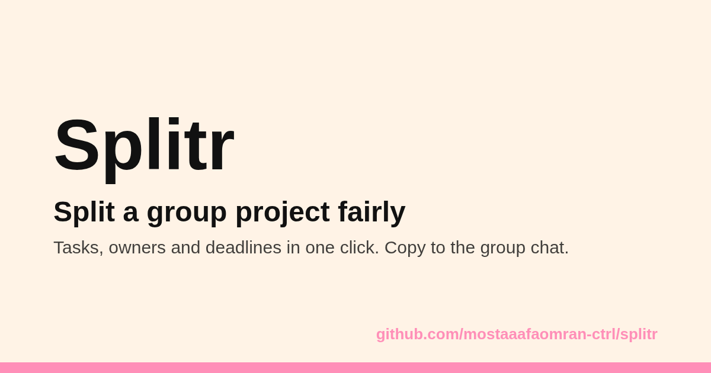

# Splitr

Group project task splitter with deadlines.

**Live:** https://mostaaafaomran-ctrl.github.io/splitr/

## What it does

- One task per line, or paste a paragraph and each sentence becomes a task
- Longer tasks weigh more, so the load stays fair
- Deadlines spread to the final date, with a review day kept at the end
- Copy the plan for the group chat, or print it

## Use it

Open the live link. No signup, no server. To run it locally, clone the repo and open `index.html` in a browser.

## بالعربي

الصق المطلوب وأسماء الفريق، واحصل على توزيع عادل للمهام ومواعيد لكل واحد.

## License

MIT
